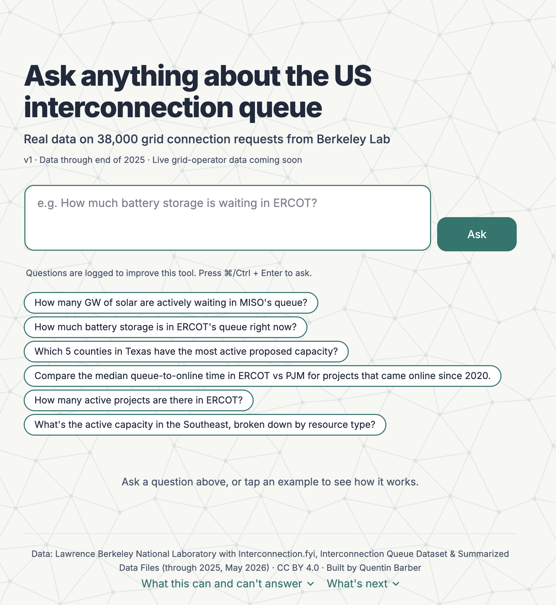
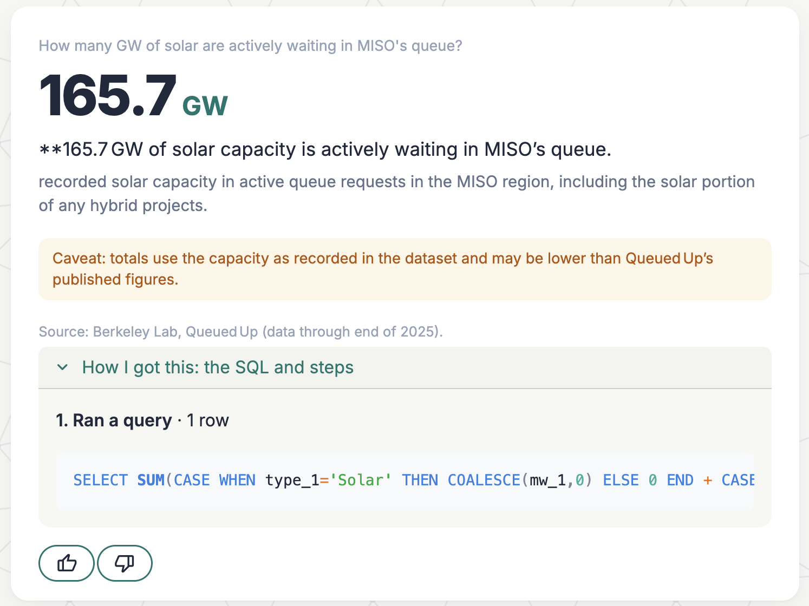

# Interconnection Queue Agent

**An AI agent that answers plain-English questions about the US interconnection queue — the backlog of energy projects waiting to connect to the grid.**

Built by [Quentin Barber](https://www.linkedin.com/in/quentinbarber/) — product leader building AI tools for the energy transition.

🌐 **Try it live:** [interconnection-queue-agent-qb.streamlit.app](https://interconnection-queue-agent-qb.streamlit.app/)
🔄 **Status:** v1 live · improving weekly from real questions · live grid-operator data coming next
🔒 **Source code:** private — happy to walk through it on request

---

## The Problem

AI data centers, solar, wind and batteries are all competing for limited grid capacity. Thousands of projects wait in interconnection queues for years, and the queue data is public but hard to use: spread across grid operators, full of jargon, and inconsistent from one region to the next.

A developer, analyst, journalist or community advocate with a simple question — *"How much battery storage is waiting in Texas?"* — usually has to download a large spreadsheet and learn its quirks first.

## What It Does

Ask a question in plain English. The agent writes and runs SQL against Berkeley Lab's **interconnection queue dataset**, compiled with Interconnection.fyi (about 38,000 interconnection requests across all seven US grid operators plus non-ISO regions, through the end of 2025) and returns:

- **The answer first**, as a single number or a small table
- **What it counted**, in plain words (e.g., "active requests in the ERCOT region")
- **Caveats** when the data has a known limit that affects the answer
- **How I got this**: the SQL and steps, so anyone can check the work

It declines questions the data can't answer (why something happened, predictions, prices) and suggests the closest question it *can* answer.

---

## How It Works

| Layer | Choice |
| --- | --- |
| Model | gpt-oss-120b (open-source) on Groq |
| Tools | `list_tables`, `describe_table`, `run_sql` |
| Data | Berkeley Lab with Interconnection.fyi (CC BY 4.0) in DuckDB |
| Guardrails (in code, not just the prompt) | Read-only database; single `SELECT` only; 200-row limit; 10-second query timeout; 8 tool steps per question; 20 questions per session |
| Tracing | Every question, tool call, SQL query, answer and 👍/👎 is logged to Supabase for error analysis |
| App | Streamlit |

---

## Product Decisions

I wrote a context spec and system prompt before building. Key decisions:

- **What a good answer is:** number first, then the definition used, scope, data date and relevant caveats. The agent may never state a number that didn't come from a query result.
- **Default definitions for ambiguous terms:** "active" means currently active requests only (verified against Berkeley Lab's published totals); "Texas" means the ERCOT grid region unless the user says "the state of Texas"; capacity for a resource type counts that resource wherever it appears in a hybrid project, without double-counting.
- **Degradation strategy:** answer with a stated default when a term is ambiguous; ask one question when there's no sensible default; decline in one sentence and offer an alternative when a question is out of scope; never guess when a query fails.
- **Never estimate missing data.** Most hybrid solar-plus-storage projects don't record their storage size, so the agent reports recorded capacity and says so.

📓 Full decision log: [`journal/decision-log.md`](journal/decision-log.md)

## What I Found in the Data

Before writing any agent code, I explored the data and logged the traps an agent would fall into:

- **Hybrid storage is mostly missing:** about 79% of solar-plus-battery requests nationally (and every hybrid in ERCOT) don't record a storage size.
- **ERCOT's active count differs from the published report by +269 requests,** while its capacity matches exactly. I tested five explanations (study stage, project type, timing, size, suspended status) and ruled each out.
- **Recorded capacity runs about 10% below the report nationally (9.5%),** with regional gaps from under 1% (CAISO) to 21% (West); ERCOT matches exactly. The report's method isn't fully documented, so the agent labels totals as "recorded capacity."
- Smaller traps: negative MW on repowered projects, rows without a queue date, and developer-estimated online dates extending to 2057.

⚠️ Full traps list: [`journal/traps.md`](journal/traps.md)

---

## Evals and Iteration

I follow an Analyze → Measure → Improve loop:

1. **Test questions:** 25 questions spanning 8 user types (developers, data center site selectors, investors, utility planners, journalists, advocates), questions across the major grid operators plus nationwide questions, and deliberate traps, ambiguous terms and out-of-scope questions.
2. **Error analysis:** I read every trace myself, note the first failure, and group failures into types.
3. **Fix and measure:** change the prompt, context or code, then rerun the full set and compare.

### v0 → v1

| Failure | v0 | v1 |
| --- | --- | --- |
| Calculation error (model did math outside SQL) | 63.5% (wrong) | 63.4% (correct, computed in SQL) |
| Technical jargon (column names) in answers | 5 of 5 answers | 2 of 5 |
| Lists shown as run-on text | Yes | Table |
| "Right now" questions not flagged as historical data | Missed | Flagged |
| Response time, simple question | 22 s | 5 s |

**What v1 taught me:**
- A clear rule in a prompt isn't a guarantee: jargon leakage survived an explicit rule, so it's getting a code-based eval.
- Fixing one rule can break another: asking for "only relevant caveats" dropped a caveat that should have stayed.
- The most dangerous new failure: the agent flagged an anomaly correctly but **invented a cause** for it. Preventing unsupported explanations is the top priority for v2.

📈 Full changelog: [`journal/iteration-log.md`](journal/iteration-log.md)

---

## Roadmap

- **v2 (next):** code evals for jargon leakage and invented explanations; required capacity caveats; faster responses
- **Live data:** queue data from all seven major grid operators via [gridstatus](https://github.com/gridstatus/gridstatus), starting with ERCOT and PJM — the two biggest data center markets. Utilities outside the grid operators (Southeast, West) stay on the Berkeley Lab data.
- **Completion odds:** historical base rates ("How often do projects like this get built?")
- **Real-user evals:** every 👎 and every new question type from visitors goes into the next round

## How I Worked with AI

I used Claude Code as my pair programmer. I wrote the product spec, the definitions, and the first sections of the system prompt; checked my counts against Berkeley Lab's published regional totals; and read and judged every trace. Claude Code wrote the application code, guardrails and tooling.

---

## Data and License

Interconnection queue data: Lawrence Berkeley National Laboratory with Interconnection.fyi, *Interconnection Queue Dataset & Summarized Data Files* (through 2025, May 2026), licensed [CC BY 4.0](https://creativecommons.org/licenses/by/4.0/). [emp.lbl.gov/queues](https://emp.lbl.gov/queues)

*This tool provides analysis of public data and isn't investment, legal or engineering advice.*

## Contact

💼 [linkedin.com/in/quentinbarber](https://www.linkedin.com/in/quentinbarber/)
